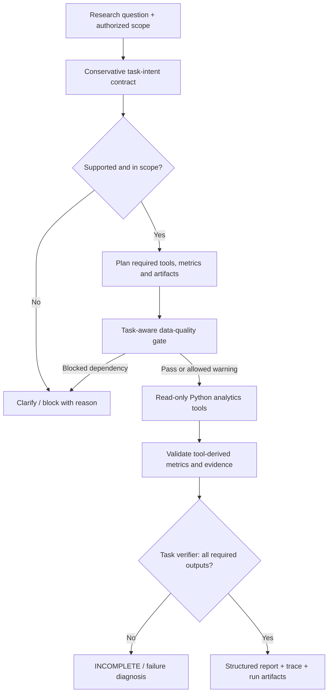

# MarketMind AI

**Task-Verified Market Research Copilot · AI Agent PM / Python Portfolio**

A **read-only research prototype** that wraps a synthetic limit-order-book analytics pipeline in a task-contract-driven tool workflow. MarketMind AI shows how an Agent product can distinguish *a tool ran* from *the user’s task was completed*, control data-quality dependencies, and tie quantitative findings to deterministic Python outputs.

> **Status: v1.2 research MVP.** The offline demo is a **fixed deterministic pipeline**, not an AI Agent. Optional real-LLM tool selection exists but **has not been benchmarked against a live model**. All market data are **generated synthetic examples**; no trading, investment advice, licensed feeds, real performance results, or user study results.


## Product problem

Financial research workflows often require repeated data validation, asynchronous trade/quote alignment, feature computation, market-depth analysis and report generation. The product hypothesis is that an Agent can help orchestrate **multi-step, non-fixed research** with explicit evidence and completion criteria. For straightforward one-metric tasks, a direct Python function or dashboard can be a better choice; an Agent is not required for everything.

**Target users (hypotheses, not interviewed users):** quantitative researchers, market-data analysts and microstructure students. **MVP scope:** synthetic datasets and descriptive analytics only.

## What is implemented

| Capability | Status |
|---|---|
| Five-level LOB, spread, relative spread, depth and imbalance calculations | Implemented in Python |
| Backward-only trade/snapshot alignment, bounded time gap | Implemented |
| Candidate newly visible price-level detection | Implemented; **not** proof of order insertion |
| Task Contract: required tools, metrics, artifacts and authorized scope | Rule-based baseline |
| TaskVerifier: task-completion and numeric evidence checks | Implemented and locally tested |
| Data-quality PASS/WARN/BLOCK by task dependency | Implemented within supported policy cases |
| Tool allowlist, bounded optional LLM orchestration and scope checks | Code present; mocked tests performed |
| Run-scoped artifacts, SQLite execution/feedback records | Local implementation |
| Streamlit research interface | Prototype; browser UAT pending |
| Live-LLM evaluation or demonstrated time/cost savings | **Not yet performed** |

## Product workflow



The current intent planner is a **limited rule-based implementation**, not full natural-language semantic understanding. LLM tool selection is optional and is not used to calculate financial numbers.

## Quick start (no API key, offline)

Python 3.11+ recommended; the supplied local project was tested with Python 3.13. The GitHub Actions workflow will check 3.11/3.12 when it runs after publication.

```bash
python -m venv .venv
source .venv/bin/activate            # macOS/Linux
# Windows PowerShell: .venv\Scripts\Activate.ps1
python -m pip install -r requirements-dev.txt
python -m pytest -q
python -m evaluation.run_evals
python -m evaluation.validate_llm_cases
python -m evaluation.select_cases --max-cases 20
python run_demo.py --mode offline
```

Results generated locally are stored in `reports/generated/` and are excluded from Git. The offline workflow **does not parse the CLI's natural-language question**.

### Optional UI

```bash
python -m pip install -r requirements-ui.txt
streamlit run app/streamlit_app.py
```

### Optional real LLM mode (may incur charges)

```bash
python -m pip install -r requirements-agent.txt
# Set OPENAI_API_KEY securely in your shell; do not put it in source control.
python run_demo.py --mode llm --question "Analyze spread and five-level OBI"
```

See [Chinese demo instructions](docs/DEMO_GUIDE_CN.md). Live-model accuracy, API cost and UI usability have **not** been measured. An optional 100-case proposed LLM evaluation catalog lives in `evaluation/llm_cases_100.jsonl`; running it requires explicit opt-in, connectivity and human review.

## Verification: exactly what the numbers mean

| Check | Local result | Interpretation |
|---|---:|---|
| Automated Python unit/integration/mock tests | **62 passed** | Checks supported Python and simulated Agent paths |
| Deterministic offline workflow evaluations | **45 / 45 passed** | Fixed scenarios on synthetic data, **not live LLM** |
| Planned LLM catalog | **100 cases prepared** | Schema/selection checked, **0 live API cases run** |
| Browser UAT, user interviews, market prediction | **Not run** | No usability, commercial ROI, trading or predictive claims |

See [verification record](docs/EXECUTION_VERIFICATION.md) and [evaluation protocol](docs/EVALUATION_FRAMEWORK.md). Rerun all checks in your environment; results may differ with dependencies or platform.

## Repository layout

```text
marketmind-ai/
├── agents/          # task planner, bounded runtime, execution storage
├── tools/           # read-only market data tools
├── verification/    # data-quality + task-completion policies
├── schemas/         # typed research output
├── src/             # synthetic data, resampling and LOB features
├── app/             # Streamlit prototype
├── evaluation/      # deterministic evals + planned LLM evaluation catalog
├── tests/           # Python automated tests
├── notebooks/       # synthetic research walkthrough
├── figures/         # synthetic chart
├── examples/        # explicitly marked synthetic/offline sample outputs
├── docs/            # PRD, architecture, product metrics, evaluation, case study
└── .github/workflows/ci.yml
```

## Product-management case study and technical docs

- [PRD — 中文](docs/PRD_CN.md) · [Task Contract Spec](docs/TASK_CONTRACT_SPEC.md)
- [Product Architecture](docs/PRODUCT_ARCHITECTURE.md) · [Product Decision Log](docs/DECISION_LOG.md)
- [Evaluation Framework](docs/EVALUATION_FRAMEWORK.md) · [Data Card](docs/DATA_CARD.md)
- [Product Metrics & Research Experiment — 中文](docs/PRODUCT_METRICS_AND_EXPERIMENT_CN.md)
- [English AI Agent PM Case Study](docs/PRODUCT_CASE_STUDY_EN.md)
- [Release-readiness criteria](docs/RELEASE_READINESS_CHECKLIST.md)
- [GitHub publishing instructions — 中文](docs/GITHUB_UPLOAD_CN.md)

## Responsible use, privacy and license

- **No real or proprietary trading data.** All data are locally generated, with a documented generator and seed. Synthetic sample date labels do not represent observed market outcomes.
- No brokerage execution, investment recommendations, inferred causal effects, or guaranteed gains.
- Do not commit `.env`, credentials, output databases, personal records, proprietary CSV, confidential assessment material, or unreviewed research results.
- Runtime reports and traces are excluded via `.gitignore`. The included `examples/` show only synthetic deterministic runs.
- MIT licensed; see [LICENSE](LICENSE). Public code does not imply access to the developer's real trading data or real-model results.
